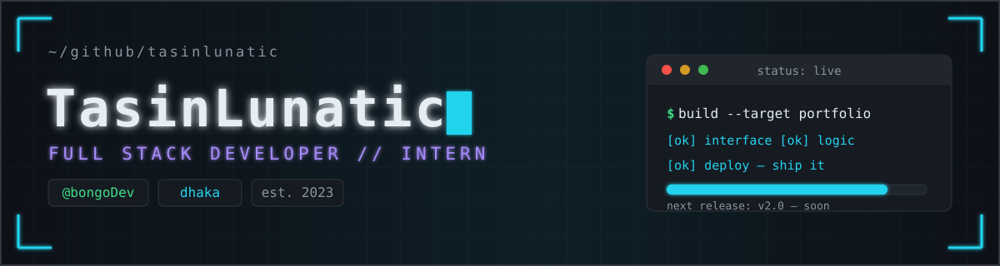
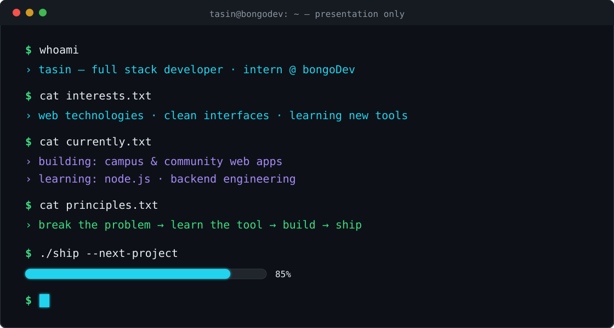

  

  

<h2 align="center">⚡ // ABOUT_ME</h2>

  Hey, I'm <b>Tasin</b> — a <b>Full Stack Developer</b> and intern, learning in public with the <a href="https://github.com/bongoDev"><b>bongoDev</b></a> community.
  I build web apps — campus tools, marketplaces, portfolios — and I'm currently going deep on <b>Node.js</b> and backend engineering.
  <i>Life is constantly teaching me, and I'm learning.</i>

<table align="center">
  <tr>
    <td align="center"><code>⚡ building</code></td>
    <td>CSS &amp; frontend polish</td>
    <td align="center"><code>🌱 learning</code></td>
    <td>Node.js</td>
  </tr>
  <tr>
    <td align="center"><code>🤝 collaborate</code></td>
    <td>Web design</td>
    <td align="center"><code>🧭 need help</code></td>
    <td>Backend</td>
  </tr>
  <tr>
    <td align="center"><code>💬 ask me</code></td>
    <td>Frontend technology</td>
    <td align="center"><code>📬 reach me</code></td>
    <td><a href="mailto:ahmedtasin207@gmail.com">ahmedtasin207@gmail.com</a></td>
  </tr>
</table>

<table align="center">
  <tr>
    <td align="center"><code>role</code></td>
    <td>Full Stack Developer · Intern</td>
    <td align="center"><code>community</code></td>
    <td>@bongoDev</td>
  </tr>
  <tr>
    <td align="center"><code>location</code></td>
    <td>Dhaka, Bangladesh</td>
    <td align="center"><code>on github</code></td>
    <td>since Sep 2023</td>
  </tr>
</table>

<h2 align="center">🖥️ // TERMINAL</h2>

  

simulated terminal — presentation only, no real commands are executed

<h2 align="center">📊 // STATS</h2>

  
  
  

  

  

<h2 align="center">🛠️ // TECH_STACK</h2>

<table align="center">
  <tr>
    <td align="right"><code>languages</code></td>
    <td>
      
      
      
      
      
      
    </td>
  </tr>
  <tr>
    <td align="right"><code>frontend</code></td>
    <td>
      
      
      
      
      
    </td>
  </tr>
  <tr>
    <td align="right"><code>backend</code></td>
    <td>
      
      
      
      
    </td>
  </tr>
  <tr>
    <td align="right"><code>databases</code></td>
    <td>
      
      
      
    </td>
  </tr>
  <tr>
    <td align="right"><code>tools</code></td>
    <td>
      
      
      
      
      
      
    </td>
  </tr>
  <tr>
    <td align="right"><code>cloud</code></td>
    <td>
      
    </td>
  </tr>
</table>

<h2 align="center">🚀 // FEATURED_PROJECTS</h2>

<table align="center">
  <tr>
    <td width="50%" align="center">
      <h3><a href="https://github.com/TasinLunatic/Campus_Book_Market">📚 Campus_Book_Market</a></h3>
      
A web app where students sell their secondhand books and others can buy them.

      

        
        
        
      

    </td>
    <td width="50%" align="center">
      <h3><a href="https://github.com/TasinLunatic/Campus-Activity-Registration">🎓 Campus-Activity-Registration</a></h3>
      
University project — activity registration web app built with JSP + XML, Tomcat 10+ and Maven.

      

        
        
        
      

    </td>
  </tr>
  <tr>
    <td width="50%" align="center">
      <h3><a href="https://github.com/TasinLunatic/Context-API">⚛️ Context-API</a></h3>
      
Learning React, React Router and Vite while applying Tailwind.

      

        
        
        
      

    </td>
    <td width="50%" align="center">
      <h3><a href="https://github.com/TasinLunatic/react_portfolio">🗂️ react_portfolio</a></h3>
      
Personal portfolio built with React and Vite.

      

        
        
        
      

    </td>
  </tr>
  <tr>
    <td width="50%" align="center">
      <h3><a href="https://github.com/TasinLunatic/Vue-lang">🎨 Vue-lang</a></h3>
      
Learning Vue with Vite — building web apps with Vue and JavaScript.

      

        
        
      

    </td>
    <td width="50%" align="center">
      <h3><a href="https://github.com/TasinLunatic/Software-Engineering">🧪 Software-Engineering</a></h3>
      
C++ unit-testing experiment — Tetris leaderboard logic with a portable test runner.

      

        
        
        
      

    </td>
  </tr>
</table>

  <a href="https://github.com/TasinLunatic?tab=repositories">explore all repositories →</a>

<h2 align="center">✈️ // CONTRIBUTION_JET</h2>

  

auto-generated from real contribution data by GitHub Actions — <code>jet-heatmap.yml</code>

<h2 align="center">🔗 // CONNECT</h2>

  
  
  
  
  

---

  

  built with <code>☕ coffee</code> + <code>🔧 curiosity</code> in dhaka · open to collaboration — working on something interesting? <a href="mailto:ahmedtasin207@gmail.com">let's build it</a>

  © 2026 TasinLunatic · <code>./keep-learning.sh</code>

