  🇺🇸 <strong>English</strong> 

# ✨ Welcome to My Portfolio!

Here you will find projects focused on embedded systems, IoT, real-time operating systems, and software development. Below is a guide to the main repositories you can explore.

## 📝 About me

I am a Computer Science and Technology student at Taizhou University, I'm a passionate software developer , expected to graduate in June 2028. I have a strong interest in programming and its integration with physical devices and hardware.

- 🔭 I’m currently working on **CSS**

- 🌱 I’m currently learning **Node JS**

- 👯 I’m looking to collaborate on **Web Design**

- 🤝 I’m looking for help with **Backend**

- 💬 Ask me about **Frontend Technology**

- 📫 How to reach me **ahmedtasin207@gmail.com**

<h3 align="left">Connect with me:</h3>

<h3 align="left">Contribution Jet</h3>

  

<h3 align="left">Languages and Tools:</h3>

                   

